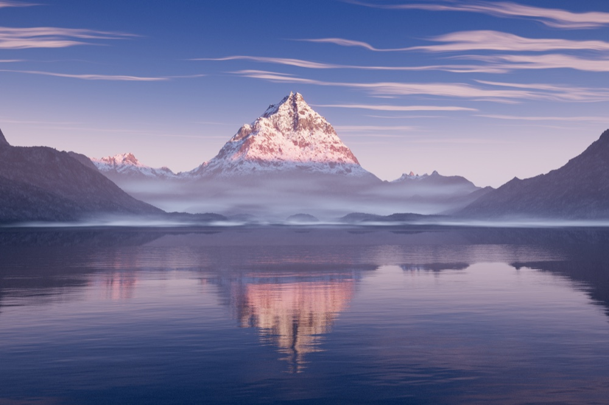
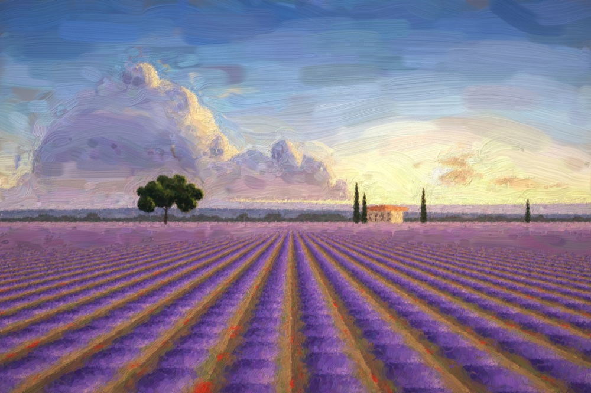
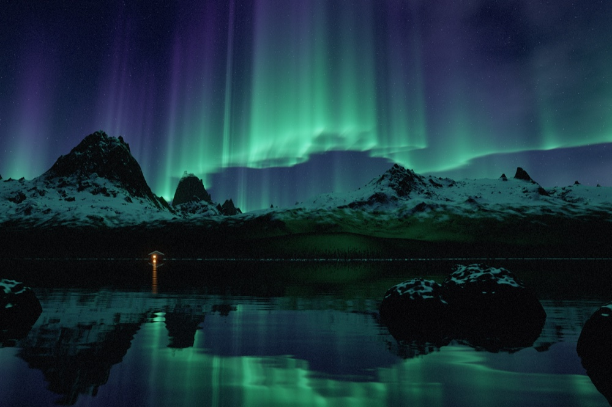
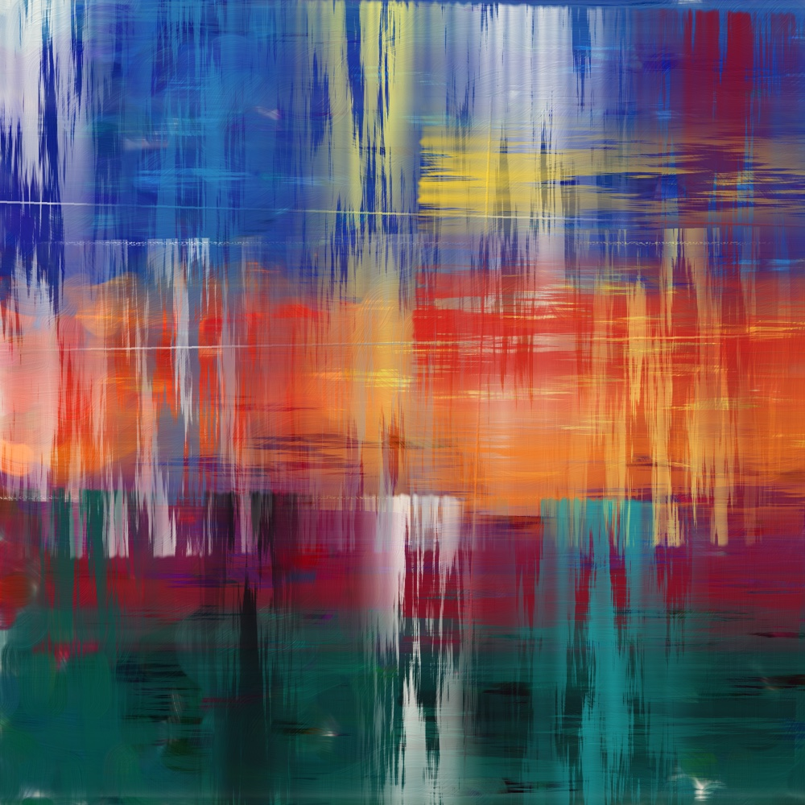
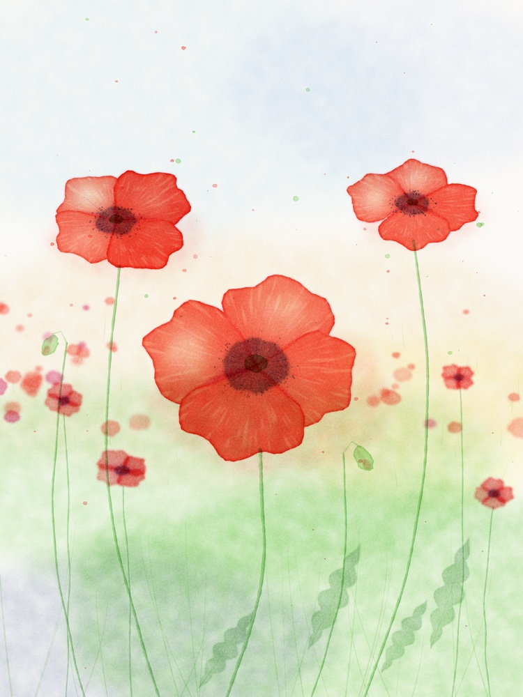
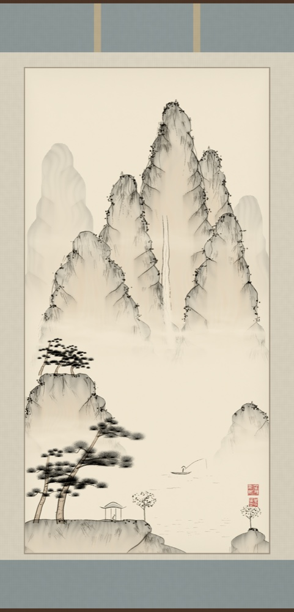

# Six Paintings

Six paintings, each made entirely in JavaScript, each in a different medium. Every one is
generated live in the browser when you open its page. Nothing is drawn from photographs,
textures or image assets. The prompt that started it is in [PROMPT.md](PROMPT.md).

<table>
<tr>
<td width="33%" valign="top"><a href="renders/alpenglow.png"></a><br><b>I.</b> Alpenglow</td>
<td width="33%" valign="top"><a href="renders/lavender.png"></a><br><b>II.</b> Lavender, Late Light</td>
<td width="33%" valign="top"><a href="renders/aurora.png"></a><br><b>IV.</b> The Sky Over Ravnvatn</td>
</tr>
<tr>
<td valign="top"><a href="renders/strata.png"></a><br><b>V.</b> Strata</td>
<td valign="top"><a href="renders/watercolour.png"></a><br><b>VI.</b> Poppies, After Rain</td>
<td valign="top"><a href="renders/shanshui.png"></a><br><b>III.</b> Ten Thousand Valleys, Pines and Mist</td>
</tr>
</table>

Open `index.html` in a browser (Chrome, Safari or Firefox). Each painting takes a few seconds
to paint itself. On a painting's page:

- `←` / `→` walk the gallery
- `S` saves the canvas as a PNG
- `R` paints a new variation with a fresh seed (`?seed=...` in the URL is reproducible)
- `Esc` returns to the gallery

Full-resolution renders of the default versions are in `renders/`.

## The paintings

| | Painting | Medium | How it's made |
|---|---|---|---|
| I | **Alpenglow** | Realism | WebGL2 raymarcher. Derivative-eroded terrain with a glacial horn, soft sun shadows, snow settling by slope and altitude, and alpenglow cut by the earth's shadow. Also height fog, marched fog banks, a belt-of-Venus sky, cirrus, and a lake with glossy wind patches. Tone-mapped (ACES) with bloom and grain. |
| II | **Lavender, Late Light** | Oil | A shader composes the motif: a sphere-built cumulus with self-shadowing, a lit oak, cypresses, a farmhouse and the rows. `lib/oil.js` then paints it coarse to fine (Hertzmann-style) with bristle brushes that run dry, carry wet paint and leave ridges. The impasto relief is lit at the end. |
| III | **Ten Thousand Valleys, Pines and Mist** | Ink | Ink density on fibrous xuan paper, rendered by absorption. Stacked-boulder peaks are built front to back so contours tuck behind each other, with hemp-fibre texture strokes in dry brush, moss dots, mist bands and a waterfall. Also pines with needle wheels, a pavilion, a boat, light ochre and indigo washes, seals and a silk mounting. |
| IV | **The Sky Over Ravnvatn** | Night | Aurora curtains marched through stacked altitude layers so they fold in perspective, plus stars and the Milky Way. Raymarched snowy peaks and boulders are lit by the aurora, the lake reflects it, and a painted spruce forest and one lit cabin sit on the far shore. |
| V | **Strata** | Abstract | A squeegee simulation over a brushed, still-wet underpainting. A loaded blade deposits paint, skips in torn streaks over the relief, picks up and smears paint, scrapes back to dry layers, and leaves ridges where it pauses or lifts. |
| VI | **Poppies, After Rain** | Watercolour | Pigments add as optical absorbance, so glazes mix like real ones. Washes darken at their drying edges, granulate into cold-press paper, and bloom wet-in-wet. Petals claim their paper front to back. Also a pencil underdrawing, crinkled petals, stamens and splatter. |

## Layout

```
index.html            the gallery
paintings/*.html|js   one page and one script per painting
lib/core.js           seeded RNG, simplex noise, colour, blur, progressive runner, keys
lib/gl.js             tiled multi-pass WebGL2 renderer (float targets, R2 jittered AA)
lib/oil.js            the oil painting engine (strokes, bristles, impasto lighting)
lib/frame.css         gallery wall, frames and placards
renders/              full-resolution PNGs and gallery thumbnails
tools/render.mjs      headless renderer that writes the PNGs in renders/
PROMPT.md             the prompt
```

Add `?scale=0.5` to any painting's URL for a faster, smaller preview.

To regenerate the renders, run `cd tools && npm install && node render.mjs`. It drives a local Chrome, so set
`CHROME` to its executable if Chrome isn't in the default macOS location. You can name individual paintings,
pass `--query seed=abc` for a variation, and use `--out <dir>` to write somewhere else.
